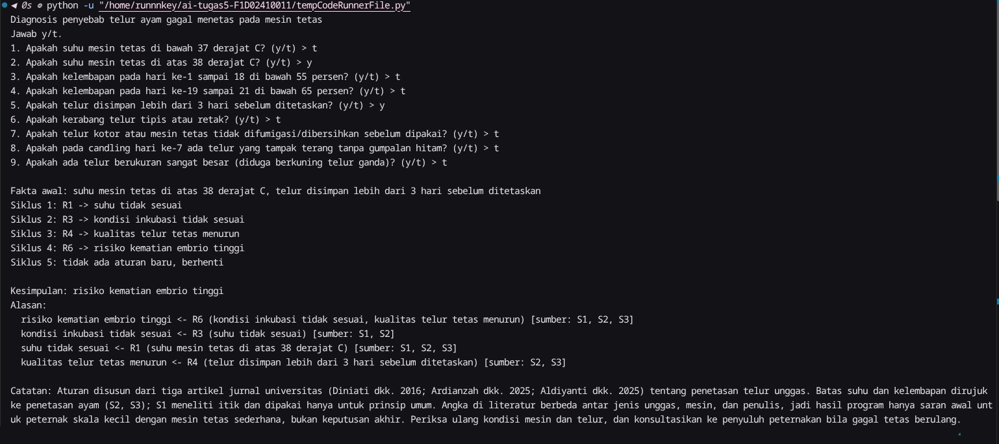
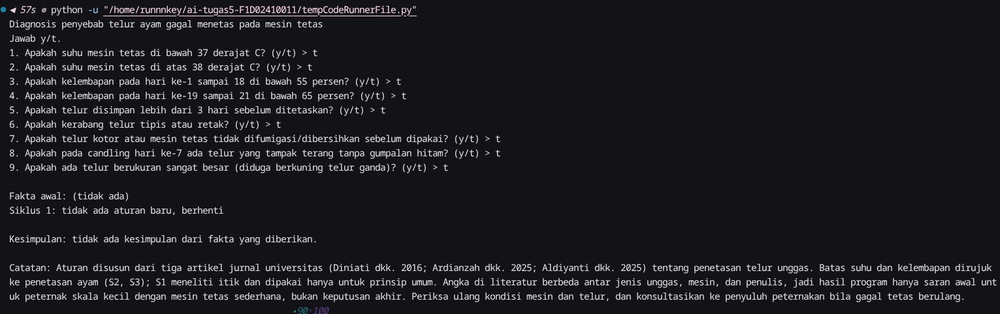
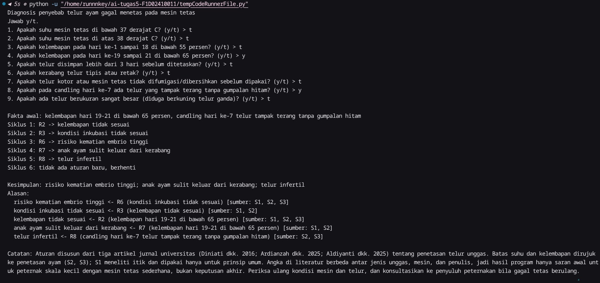

# Tugas 5 — Sistem Pakar Sederhana: Penyebab Telur Gagal Menetas pada Mesin Tetas

## 1. Identitas
- Nama: Kamrun SyaH Syahidu
- NIM: F1D02410011
- Mata kuliah: Kecerdasan Buatan (MKL1303131), Teknik Informatika UNRAM

## 2. Topik dan cara menjalankan
Topik: diagnosis penyebab telur ayam gagal menetas pada mesin tetas (suhu, kelembapan, kondisi telur, dan hasil candling).

- Bahasa: Python 3 (diuji dengan Python 3.10+), tanpa library tambahan.
- File: `main.py` (mesin), `kb_tetas.json` (basis aturan).
- Perintah (jalankan dari folder repository):

```
python main.py
```

Jawab pertanyaan dengan `y` atau `t`.

## 3. Sumber dan aturan


kode          : S1
sumber        : Diniati, Rukmiasih & Afnan, R. (2016). *Pengaruh Waktu Dimulainya Pendinginan Selama Penetasan terhadap Daya Tetas Telur Itik Persilangan Cihateup Alabio.* Jurnal Ilmu Produksi dan Teknologi Hasil Peternakan 4(1):251-256 (IPB). https://journal.ipb.ac.id/index.php/ipthp/article/download/15737/11601 
tanggal akses : 

kode          : S2 
sumber        : Ardianzah, F., Humaidah, N. & Wadjdi, F. (2025). *Pengaruh Umur Induk terhadap Breakout Infertil dan Un Hatch Telur Tetas di Perusahaan Pembibitan Komersial.* Dinamika Rekasatwa 8(1):66-69, Fakultas Peternakan, Universitas Islam Malang. https://jim.unisma.ac.id/index.php/fapet/article/download/26953/20394
tanggal akses : 12 November 2026

kode          : S3 
sumber        : Aldiyanti, A., Rizkuna, A., Manullang, J. R. & Fajrih, N. (2025). *Optimasi Penetasan Ayam Kampung: Pengaruh Variasi Bobot Telur terhadap Fertilitas dan Daya Tetas.* Aves: Jurnal Ilmu Peternakan 19(2):7-11, Universitas Mulawarman. https://ejournal.unisbablitar.ac.id/index.php/aves/article/download/5280/2488/21049 
tanggal akses : 12 November 2026

Aturan ditulis dengan kata-kata sendiri (parafrasa), bukan kutipan.

| Aturan |                                        IF                                                       |                  THEN                |   Sumber   |
|--------|-------------------------------------------------------------------------------------------------|--------------------------------------|------------|
|   R1   | suhu mesin < 37 °C **OR** suhu mesin > 38 °C                                                    | suhu tidak sesuai                    | S1, S2, S3 |
|   R2   | kelembapan hari 1–18 < 55% **OR** kelembapan hari 19–21 < 65%                                   | kelembapan tidak sesuai              | S1, S2, S3 |
|   R3   | suhu tidak sesuai **OR** kelembapan tidak sesuai                                                | kondisi inkubasi tidak sesuai        | S1, S2     |
|   R4   | telur disimpan > 3 hari **OR** kerabang tipis/retak                                             | kualitas telur tetas menurun         | S2, S3     |
|   R5   | telur kotor atau mesin tidak difumigasi                                                         | risiko infeksi mikroba               | S2, S3     |
|   R6   | kondisi inkubasi tidak sesuai **OR** kualitas telur tetas menurun **OR** risiko infeksi mikroba | risiko kematian embrio tinggi        | S1, S2, S3 |
|   R7   | kelembapan hari 19–21 < 65%                                                                     | anak ayam sulit keluar dari kerabang | S1, S2     |
|   R8   | candling hari ke-7: telur terang tanpa gumpalan hitam                                           | telur infertil                       | S2, S3     |
|   R9   | telur berukuran sangat besar (diduga kuning ganda)                                              | telur tidak layak tetas              | S3         |

Aturan yang memakai hasil aturan lain: R3 (dari R1/R2) dan R6 (dari R3, R4, R5).

Catatan perbedaan sumber: S1 meneliti itik (suhu 38–39 °C), sedangkan S2 dan S3 meneliti ayam (37–38 °C dan 37,5 ± 0,5 °C), sehingga batas suhu dan kelembapan diambil dari S2 dan S3 dan S1 hanya dipakai untuk prinsip umum (suhu terlalu tinggi dan kelembapan terlalu rendah merugikan penetasan). Batas kelembapan akhir (65%) diambil dari S3 dan lebih rendah dari angka saat pipping di S2 (70–75%), sehingga "di bawah 65%" dipakai agar tidak bertentangan dengan keduanya.

## 4. Metode: Forward Chaining
Forward chaining dipilih karena peternak biasanya punya data berupa pengamatan (suhu, kelembapan, kondisi telur) lalu ingin tahu masalah apa yang bisa disimpulkan. Hasil satu aturan (misalnya "suhu tidak sesuai") menjadi syarat aturan berikutnya.

Langkah:
1. Fakta yang tidak pernah menjadi hasil aturan manapun ditanyakan ke user; jawaban "y" masuk ke memori.
2. Cari aturan yang syaratnya terpenuhi (mode `dan` = semua, `atau` = salah satu) dan hasilnya belum ada di memori.
3. Jalankan aturan pertama yang cocok, tambahkan hasilnya ke memori, catat aturan asalnya.
4. Ulangi sampai tidak ada aturan baru.
5. Kesimpulan akhir = hasil yang tidak dipakai sebagai syarat aturan lain. Alasan ditelusuri mundur dari catatan aturan asal.

Aturan yang hasilnya sudah ada di memori tidak dijalankan lagi supaya program berhenti.

## 5. Tiga kasus uji

| # |                     Jawaban "ya"                             |                                    Kesimpulan                                       |
|---|--------------------------------------------------------------|-------------------------------------------------------------------------------------|
| 1 | suhu > 38 °C; telur disimpan > 3 hari                        | risiko kematian embrio tinggi                                                       |
| 2 | tidak ada (semua kondisi sesuai)                             | tidak ada (kasus negatif)                                                           |
| 3 | kelembapan hari 19–21 < 65%; candling hari ke-7 telur terang | risiko kematian embrio tinggi; anak ayam sulit keluar dari kerabang; telur infertil |

### Kasus 1
```
Fakta awal: suhu mesin tetas di atas 38 derajat C, telur disimpan lebih dari 3 hari sebelum ditetaskan
Siklus 1: R1 -> suhu tidak sesuai
Siklus 2: R3 -> kondisi inkubasi tidak sesuai
Siklus 3: R4 -> kualitas telur tetas menurun
Siklus 4: R6 -> risiko kematian embrio tinggi
Siklus 5: tidak ada aturan baru, berhenti

Kesimpulan: risiko kematian embrio tinggi
Alasan:
  risiko kematian embrio tinggi <- R6 (kondisi inkubasi tidak sesuai, kualitas telur tetas menurun) [sumber: S1, S2, S3]
  kondisi inkubasi tidak sesuai <- R3 (suhu tidak sesuai) [sumber: S1, S2]
  suhu tidak sesuai <- R1 (suhu mesin tetas di atas 38 derajat C) [sumber: S1, S2, S3]
  kualitas telur tetas menurun <- R4 (telur disimpan lebih dari 3 hari sebelum ditetaskan) [sumber: S2, S3]
```


### Kasus 2 (negatif)
```
Fakta awal: (tidak ada)
Siklus 1: tidak ada aturan baru, berhenti

Kesimpulan: tidak ada kesimpulan dari fakta yang diberikan.
```


### Kasus 3
```
Fakta awal: kelembapan hari 19-21 di bawah 65 persen, candling hari ke-7 telur tampak terang tanpa gumpalan hitam
Siklus 1: R2 -> kelembapan tidak sesuai
Siklus 2: R3 -> kondisi inkubasi tidak sesuai
Siklus 3: R6 -> risiko kematian embrio tinggi
Siklus 4: R7 -> anak ayam sulit keluar dari kerabang
Siklus 5: R8 -> telur infertil
Siklus 6: tidak ada aturan baru, berhenti

Kesimpulan: risiko kematian embrio tinggi; anak ayam sulit keluar dari kerabang; telur infertil
Alasan:
  risiko kematian embrio tinggi <- R6 (kondisi inkubasi tidak sesuai) [sumber: S1, S2, S3]
  kondisi inkubasi tidak sesuai <- R3 (kelembapan tidak sesuai) [sumber: S1, S2]
  kelembapan tidak sesuai <- R2 (kelembapan hari 19-21 di bawah 65 persen) [sumber: S1, S2, S3]
  anak ayam sulit keluar dari kerabang <- R7 (kelembapan hari 19-21 di bawah 65 persen) [sumber: S1, S2]
  telur infertil <- R8 (candling hari ke-7 telur tampak terang tanpa gumpalan hitam) [sumber: S2, S3]
```


## 6. Batas keberlakuan
Pengetahuan dalam program ini berasal dari tiga artikel jurnal universitas tentang penetasan unggas (satu pada itik, dua pada ayam) dan hanya berlaku untuk penetasan telur ayam dengan mesin tetas. Angka suhu dan kelembapan di literatur berbeda antar jenis unggas, mesin, dan penulis, sehingga aturan ini hanya cocok sebagai panduan awal bagi peternak skala kecil. Hasil program adalah saran, bukan keputusan akhir; periksa kembali kondisi mesin dan telur, dan konsultasikan dengan penyuluh peternakan bila gagal tetas terjadi berulang. Catatan yang sama ditampilkan di akhir keluaran program.

## 7. Penggunaan alat bantu AI
**Alat:** Claude Sonnet 5.5 (Anthropic), diakses lewat aplikasi Claude, November 2026.

**Dipakai untuk:**
- Mencari kandidat sumber jurnal tentang penetasan telur.
- Menyusun draf awal aturan, kode `main.py`, dan kerangka README.
- Menjelaskan cara kerja forward chaining.

**Saya kerjakan dan verifikasi sendiri:**
- [Membuka dan membaca ketiga jurnal, dan memeriksa bahwa setiap ambang batas pada aturan memang berasal dari sumber tersebut.]
- [Menyesuaikan aturan: tulis perubahan yang benar-benar kamu buat.]
- [Menjalankan program, menguji tiga kasus, dan mengambil tangkapan layar sendiri.]

**Catatan:** Kode dan aturan di repositori ini awalnya berasal dari draf AI. Saya sudah membaca logikanya dan siap menjelaskannya.